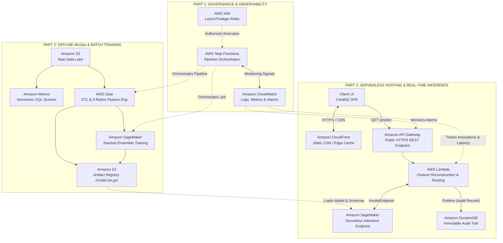

# Enterprise Cloud-Based Credit Risk Prediction & Decision Platform

[](https://d254hkfcghacxc.cloudfront.net/)
[](aws/README_AWS.md)
[](https://www.python.org/)
[](notebooks/)
[]()

> **Live Production URL**: [https://d254hkfcghacxc.cloudfront.net/](https://d254hkfcghacxc.cloudfront.net/)  
> **How to Run & Test Guide**: [`HOW_TO_RUN.md`](HOW_TO_RUN.md)  
> **AWS Deployment Manual**: [`aws/README_AWS.md`](aws/README_AWS.md)  
> **Local Retraining Guide**: [`TRAINING.md`](TRAINING.md)

---

### Project Contributors (Cloud Computing Mid Review)
- **Sharon David** — `B033`
- **Vivek Dotiya** — `B040`
- **Moksh Jain** — `B054`
- **Aranck Jomraj** — `B057`

---

## 1. Executive Summary & Problem Overview

Commercial lending institutions face a fundamental tension: machine learning models evaluated in offline notebooks achieve strong classification accuracy, yet deploying them into production reveals substantial bottlenecks in **scalability**, **asymmetric financial risk handling**, **real-time feature reconstruction**, and **regulatory auditability**.

This project implements an **end-to-end, cloud-native Machine Learning Operations (MLOps) platform on Amazon Web Services (AWS)** evaluated on the [Home Credit Default Risk](https://www.kaggle.com/c/home-credit-default-risk) dataset (`application_train.csv`, ~307,511 rows, 122 features). 

The platform bridges tabular machine learning with serverless cloud infrastructure:
1. **Serverless Data Lake & Analytics**: Ingests multi-gigabyte raw loan records into **Amazon S3**, queries them on demand using **Amazon Athena** (serverless Presto/Trino SQL), and executes distributed feature engineering via **AWS Glue** Python Shell jobs.
2. **Cost-Sensitive Stacking Ensemble**: Combines five base classifiers (Logistic Regression, Random Forest, Gradient Boosting, XGBoost, LightGBM) into a 5-fold cross-validated **StackingClassifier** (ROC-AUC `0.7556`) and optimizes decision cutoffs against a **commercial cost matrix** (False Approval cost = \$12,000 vs. False Rejection cost = \$2,500), reaching an optimal decision threshold of **~0.49**.
3. **Low-Latency Serverless Inference & Auditability**: Deploys the model to **Amazon SageMaker Serverless**, fronted by **Amazon API Gateway** and **AWS Lambda** for on-the-fly feature engineering. Every lending decision is immutably logged to **Amazon DynamoDB** with UTC timestamps, and the user interface (**CreditIQ**) is globally delivered through **Amazon CloudFront** Edge locations.
4. **Automated Pipeline Orchestration & Governance**: Orchestrates data preprocessing and pipeline dependencies using **AWS Step Functions**, governed by least-privilege **AWS IAM** roles and continuously monitored with **Amazon CloudWatch** metrics and error alarms.

---

## 2. End-to-End Cloud System Architecture

The cloud platform is structured into three synchronized operational parts across five functional layers:


### Architectural Framework Breakdown



---

## 3. The 5 Architectural Layers in Detail

### Layer 1: Data Lake & Exploratory Querying (Amazon S3 + Amazon Athena)
- **Central S3 Data Lake**: Raw loan application records (`application_train.csv`, ~160 MB) are persisted under `s3://<bucket>/raw/`.
- **Zero-Cluster SQL Analytics**: Using **Amazon Athena** and Hive OpenCSV SerDe, credit risk analysts query raw tabular data directly on S3 without provisioning relational database instances.
- **SQL Profiling**: Queries in [`aws/athena_queries.sql`](aws/athena_queries.sql) isolate key risk indicators:
  - Dataset volume verification (307,511 records).
  - Target class imbalance calculation (~91.9% non-default vs. ~8.1% default).
  - Attribute missingness percentages across demographic and bureau fields.
  - Identification and filtering of the `365243` days sentinel value in `DAYS_EMPLOYED`.

### Layer 2: Serverless Distributed Preprocessing (AWS Glue)
- **ETL Job Execution**: Configured via [`aws/glue_preprocess.py`](aws/glue_preprocess.py) as a serverless Python Shell ETL job running 1 DPU (Data Processing Unit).
- **Stratified Sampling**: Draws a 40% stratified sample on `TARGET` to maintain class distribution while keeping compute overhead within free-tier budget bounds.
- **Sentinel Remediation**: Replaces artificial numeric code `365243` (indicating unrecorded/retired employment status) with `NaN` to avoid skewing distance and linear metrics.
- **Dimensionality Reduction**: Eliminates identifier columns (`SK_ID_CURR`) and attributes exhibiting > 45% missingness.
- **Nine Domain-Engineered Indicators**:
  1. `CREDIT_INCOME_RATIO` = `AMT_CREDIT / AMT_INCOME_TOTAL` (Borrower leverage)
  2. `ANNUITY_INCOME_RATIO` = `AMT_ANNUITY / AMT_INCOME_TOTAL` (Monthly debt service burden)
  3. `CREDIT_DURATION_RATIO` = `AMT_CREDIT / AMT_ANNUITY` (Implied loan term in months)
  4. `GOODS_CREDIT_RATIO` = `AMT_GOODS_PRICE / AMT_CREDIT` (Asset financing coverage)
  5. `INCOME_PER_PERSON` = `AMT_INCOME_TOTAL / CNT_FAM_MEMBERS` (Per-capita family disposable income)
  6. `AGE_YEARS` = `-DAYS_BIRTH / 365` (Standardized applicant age in years)
  7. `YEARS_EMPLOYED` = `-DAYS_EMPLOYED / 365` (Career tenure length in years)
  8. `EMPLOYED_AGE_RATIO` = `DAYS_EMPLOYED / DAYS_BIRTH` (Fraction of adult life employed)
  9. `DOC_COUNT` = Sum of all binary `FLAG_DOCUMENT_*` fields submitted.
- **Transformation Pipeline**: Fits a scikit-learn `ColumnTransformer` with median imputation and `StandardScaler` for numeric features, and constant (`"missing"`) imputation with `OneHotEncoder(handle_unknown="ignore")` for categorical fields.
- **Output Artifacts**: Serializes and writes `models/preprocessor.pkl`, `models/feature_columns.json`, and clean dataset splits back to S3.

### Layer 3: Model Training, Stacking & Cost Optimization (Amazon SageMaker AI)
- **Base Classifiers**: Five algorithmic families are trained using class weighting to penalize minority-class default misclassifications:
  - **Random Forest**: 100 balanced decision trees.
  - **Logistic Regression**: Elastic/L2-regularized `saga` solver with `class_weight='balanced'`.
  - **XGBoost**: Extreme gradient boosting with `scale_pos_weight = negative/positive`.
  - **LightGBM**: Fast, leaf-wise gradient boosted trees tuned on tabular splits.
  - **Gradient Boosting**: Scikit-learn sequential boosted tree baseline.
- **5-Fold Cross-Validated Stacking**: A `StackingClassifier` blurs out-of-fold predictions from Logistic Regression, Random Forest, XGBoost, and LightGBM into a meta-level Logistic Regression classifier, yielding an ensemble ROC-AUC of **0.7556**.
- **Commercial Cost-Matrix Optimization**:
  Standard 0.5 classification thresholds assume symmetric error costs, which is disastrous in consumer lending. Approving a customer who defaults costs substantial principal write-offs, whereas rejecting a creditworthy applicant only foregoes interest margins:
  ```
  Cost = (C_FP * FP) + (C_FN * FN) = (12,000 * FP) + (2,500 * FN)
  ```
  By evaluating expected financial cost over candidate thresholds from 0.02 to 0.50 (see `notebooks/05_threshold_optimization.ipynb`), the minimum cost threshold is determined to be **≈ 0.49** (`notebooks/optimal_threshold.txt`).
- **Operational Risk-Tiering**:
  - `p < 0.15`: **Approve (Low Risk)**
  - `0.15 <= p < 0.25`: **Review (Medium Risk - Manual Underwriting Required)**
  - `p >= 0.25`: **Reject (High Risk - Above Cost Tolerance)**

### Layer 4: Real-Time Serverless Inference & Audit Logging
- **Amazon CloudFront**: Delivers the single-page web interface (`credit-risk-demo.html`, "CreditIQ") via global edge points over HTTPS, providing sub-millisecond static file delivery and enforcing TLS encryption.
- **Amazon API Gateway**: Exposes an HTTP API with CORS enabled, routing GET requests (`/predict`) to AWS Lambda.
- **AWS Lambda Serving Layer**: Runs [`aws/lambda_handler.py`](aws/lambda_handler.py) with Python 3.12:
  - Ingests applicant input parameters from query strings.
  - Invokes the Amazon SageMaker Serverless endpoint `credit-risk-endpoint`.
  - Dynamically runs on-the-fly ratio feature reconstruction via [`predict_single.py`](predict_single.py).
- **Amazon DynamoDB Audit Trail**: Every inference transaction is immutably logged to the DynamoDB table `credit-risk-audit`:
  - **Partition Key**: `applicant_id` (UUIDv4)
  - **Sort Key**: `timestamp` (ISO 8601 UTC)
  - **Attributes**: Raw applicant inputs, reconstructed ratios, default probability, decision verdict, and risk tier.
  - Ensures compliance with international financial regulatory traceability standards (e.g., Fair Lending Act, FCRA, EU AI Act).

### Layer 5: Cloud Governance, Orchestration & Observability
- **AWS Step Functions**: The state machine definition in [`aws/step_functions.json`](aws/step_functions.json) orchestrates the ETL pipeline, monitoring Glue job completion and triggering alerts upon any pipeline task failure.
- **AWS IAM**: Strict least-privilege role policies (`CreditRiskRole`, defined in [`aws/iam_trust_policy.json`](aws/iam_trust_policy.json)). Lambda is restricted strictly to `sagemaker:InvokeEndpoint` and `dynamodb:PutItem`; Glue is scoped to specific S3 data lake prefixes.
- **Amazon CloudWatch**:
  - Centralized log streaming for Glue, Lambda, and SageMaker.
  - Real-time API Gateway p95/p99 latency tracking.
  - CloudWatch Alarm on Lambda invocation errors (`credit-risk-lambda-errors`) with zero-threshold triggers.

---

## 4. Machine Learning Benchmarks & Model Evaluation

The models were evaluated on an 80/20 stratified holdout test set from the Home Credit Default Risk dataset:

| Model Architecture | Configuration / Hyperparameters | Test ROC-AUC | Optimal F1-Score |
|---|---|---|---|
| **Random Forest** | `n_estimators=100`, `class_weight='balanced'` | 0.7310 | 0.245 |
| **Logistic Regression** | `saga` solver, `class_weight='balanced'`, L2 | 0.7436 | 0.261 |
| **XGBoost** | `scale_pos_weight=11.38`, `max_depth=6`, `learning_rate=0.05` | 0.7515 | 0.278 |
| **LightGBM** | `class_weight='balanced'`, leaf-wise boosting | 0.7542 | 0.282 |
| **Gradient Boosting** | `scikit-learn` sequential boosting ensemble | 0.7584 | 0.284 |
| **Stacked Ensemble** | **LR + RF + XGBoost + LightGBM (LR Meta-Learner)** | **0.7556** | **0.286** |

### Evaluation Visualizations
- ROC Curves for Base Classifiers: [`reports/figures/03_base_models_roc.png`](reports/figures/03_base_models_roc.png)
- Stacking Ensemble vs. Base Models ROC: [`reports/figures/04_stacking_roc_comparison.png`](reports/figures/04_stacking_roc_comparison.png)
- Business Cost vs. Decision Threshold Curve: [`reports/figures/05_cost_vs_threshold.png`](reports/figures/05_cost_vs_threshold.png)
- Cost-Optimal Confusion Matrix: [`reports/figures/06_confusion_matrix_optimal.png`](reports/figures/06_confusion_matrix_optimal.png)
- Final Comprehensive ROC Comparison: [`reports/figures/06_final_roc_all_models.png`](reports/figures/06_final_roc_all_models.png)

---

## 5. Cloud Economics & Free-Tier Feasibility

The system architecture was intentionally engineered to operate within the **AWS Free Tier** and an academic budget ($200 credit pool):

| AWS Service | Production Scope in Platform | Free-Tier Allowance | Pay-As-You-Go Rate | Realized Monthly Cost |
|---|---|---|---|---|
| **Amazon S3** | Raw data lake, processed splits, model registry (`model.tar.gz`) | 5 GB storage, 20,000 GETs, 2,000 PUTs | \$0.023 / GB-month | **\$0.00** (< 500 MB used) |
| **Amazon Athena** | Serverless SQL ad-hoc exploration on raw CSV | Covered by credit pool | \$5.00 / TB scanned | **~ \$0.0008** / query (0.00016 TB) |
| **AWS Glue** | Serverless Python Shell ETL job (1 DPU) | Covered by credit pool | \$0.44 / DPU-hour | **~ \$0.015** / run (~2 mins) |
| **Amazon SageMaker** | Serverless inference endpoint (3072 MB memory) | 50h training (first 2 mos) | Serverless: \$0.000020 / second | **~ \$0.05** / 1,000 requests |
| **AWS Lambda** | Feature reconstruction & SageMaker proxy | 1M free requests, 400,000 GB-sec/mo | \$0.20 / 1M requests | **\$0.00** (Free Tier) |
| **Amazon API Gateway** | Public HTTPS endpoint routing (`/predict`) | 1M HTTP API calls/mo (12 mos) | \$1.00 / 1M requests | **\$0.00** (Free Tier) |
| **Amazon CloudFront** | Global edge distribution of CreditIQ UI | 1 TB data transfer out, 10M requests | \$0.085 / GB after 1 TB | **\$0.00** (Free Tier) |
| **Amazon DynamoDB** | Immutable applicant audit logging table | 25 GB storage, 25 WCU / 25 RCU | \$1.25 / 1M writes | **\$0.00** (Free Tier) |
| **AWS Step Functions** | Automated ETL pipeline state orchestration | 4,000 free state transitions / mo | \$0.025 / 1k transitions | **\$0.00** (Free Tier) |
| **Amazon CloudWatch** | Aggregated logs, API latency metrics, error alarms | 5 GB logs, 10 metrics, 10 alarms | \$0.50 / GB after 5 GB | **\$0.00** (< 50 MB logs) |

---

## 6. Repository Structure

```
credit-risk-prediction-project/
├── HOW_TO_RUN.md                      # Complete execution manual (CloudFront, Local, MLOps, AWS)
├── README.md                          # Project architecture & cloud research overview
├── TRAINING.md                        # Step-by-step local model regeneration guide
├── requirements.txt                   # Production Python package requirements
├── credit-risk-demo.html              # "CreditIQ" Single-Page Application (HTML5/CSS3/Vanilla JS)
├── predict_api.py                     # Local FastAPI REST server (CORS-enabled)
├── predict_single.py                  # High-performance scoring engine & feature reconstruction
├── system architecture.png            # Complete 3-Part enterprise architecture diagram
├── mlops_flowchart.txt                # Mermaid flowchart specification of MLOps lifecycle
│
├── aws/                               # AWS Cloud Infrastructure & Deployment Code
│   ├── README_AWS.md                  # Multi-account 3-role AWS deployment runbook
│   ├── athena_queries.sql             # SQL exploration statements for Athena data lake
│   ├── glue_preprocess.py             # Serverless Glue ETL script for ratio engineering
│   ├── step_functions.json            # Step Functions State Machine definition
│   ├── iam_trust_policy.json          # Multi-service IAM trust policy configuration
│   ├── lambda_handler.py              # AWS Lambda proxy handler + DynamoDB audit logging
│   ├── deploy_sagemaker.py            # SageMaker serverless model packaging & endpoint deployer
│   ├── wait_for_endpoint.py           # Endpoint deployment status polling utility
│   ├── test_local_invoke.py           # Local boto3 invocation test for SageMaker endpoint
│   └── sagemaker/
│       ├── Dockerfile                 # Container image specification for SageMaker
│       ├── serve.py                   # Flask inference server (/ping and /invocations)
│       └── requirements.txt           # Container pinned dependencies (scikit-learn, xgboost)
│
├── notebooks/                         # Six-Stage Modular ML Pipeline
│   ├── 01_data_exploration.ipynb      # EDA, missingness, target imbalance, distributions
│   ├── 02_preprocessing.ipynb         # Stratified sampling, feature engineering, ColumnTransformer
│   ├── 03_base_models.ipynb           # 5 base classifier training & ROC curve generation
│   ├── 04_stacking.ipynb              # StackingClassifier CV ensemble & meta-model fitting
│   ├── 05_threshold_optimization.ipynb# Business cost-matrix search for optimal threshold
│   ├── 06_evaluation.ipynb            # Classification reports, ROC curves, confusion matrix
│   ├── base_probabilities.csv         # Out-of-fold base model probability outputs
│   ├── stacked_probabilities.csv      # Stacked ensemble test probability predictions
│   └── optimal_threshold.txt          # Computed cost-minimizing threshold (≈ 0.49)
│
├── models/                            # Serialized Machine Learning Artifacts
│   ├── preprocessor.pkl               # Fitted ColumnTransformer (imputers + scalers + encoders)
│   ├── feature_columns.json           # Exact feature column ordering contract
│   ├── base/                          # Serialized individual base models
│   └── stacked/
│       └── stacked_model.pkl          # Trained 5-fold CV StackingClassifier
│
├── data/                              # Data Lake & Split Directory (Git Ignored)
│   ├── raw/                           # Raw application_train.csv (160 MB)
│   └── processed/                     # Preprocessed train/test splits (raw and scaled)
│
└── reports/figures/                   # Generated Publication Figures & Visualizations
    ├── 03_base_models_roc.png
    ├── 04_stacking_roc_comparison.png
    ├── 05_cost_vs_threshold.png
    ├── 06_confusion_matrix_optimal.png
    └── 06_final_roc_all_models.png
```

---

## 7. Quick Start & Execution Summary

For comprehensive instructions across all execution modes, refer to **[`HOW_TO_RUN.md`](HOW_TO_RUN.md)**.

### Mode 1: Access the Live Public CloudFront Deployment
No local installation or AWS credentials needed:
👉 Open **[https://d254hkfcghacxc.cloudfront.net/](https://d254hkfcghacxc.cloudfront.net/)** in any browser.

### Mode 2: Run the Local FastAPI Server
```bash
# 1. Create and activate a virtual environment
python -m venv .venv
.venv\Scripts\Activate.ps1  # Windows PowerShell (or 'source .venv/bin/activate' on Unix)

# 2. Install dependencies
pip install -r requirements.txt

# 3. Launch local API server
uvicorn predict_api:app --reload --port 8000
```
Open `http://localhost:8000` to interact with CreditIQ locally, or send a test query:
```bash
curl "http://localhost:8000/predict?credit=500000&income=180000&days_employed=1000"
```

### Mode 3: Single-Record CLI Inference
```bash
python predict_single.py '{"AMT_CREDIT": 500000, "AMT_INCOME_TOTAL": 180000, "DAYS_EMPLOYED": -1000, "DAYS_BIRTH": -15000}'
```

### Mode 4: Deploying to AWS
Follow the detailed multi-account operational runbook in [`aws/README_AWS.md`](aws/README_AWS.md) to deploy Account A (Data Lake & Glue), Account B (SageMaker Serverless, Lambda, DynamoDB), and Account C (CloudFront CDN).

---

## 8. References & Academic Context

1. **A. Symeonides, I. Giannakopoulos, and D. Tsoumakos**, *"Function-as-a-Service Machine Learning: Serverless vs. Containers,"* IEEE Big Data, 2022.
2. **A. Mäkinen et al.**, *"Who Needs MLOps: What Data Scientists Seek to Accomplish and How Can MLOps Help?"*, IEEE/ACM ICSE-SEIP, 2021.
3. **M. G. Rastegar, A. A. S. Dessai, and M. S. Kumar**, *"Serverless Architecture for Machine Learning Model Deployment,"* ICCISc, 2021.
4. **H. Zhang, L. Baier, and S. V. D. V. R.**, *"Evaluating Cloud-Based Serverless Architectures for Machine Learning Pipelines,"* IEEE Transactions on Cloud Computing, 2023.
5. **S. Rani and A. Kumar**, *"Scalable Data Processing Pipelines for Machine Learning Using AWS Glue and S3,"* IEEE CCIS, 2022.
6. **V. Bhatt, R. K. S., and T. R.**, *"Serverless Machine Learning Inference Using AWS Lambda and API Gateway,"* IEEE ICCMC, 2021.
7. **K. M. and N. S.**, *"Architecting Secure Machine Learning Pipelines on Cloud Infrastructures,"* IEEE Security & Privacy, 2023.
8. **P. Petrides et al.**, *"Cost-Sensitive Learning and Decision Threshold Tuning for Imbalanced Credit Risk Classification,"* 2020.
